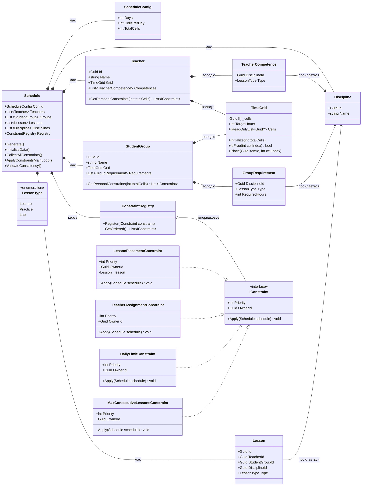
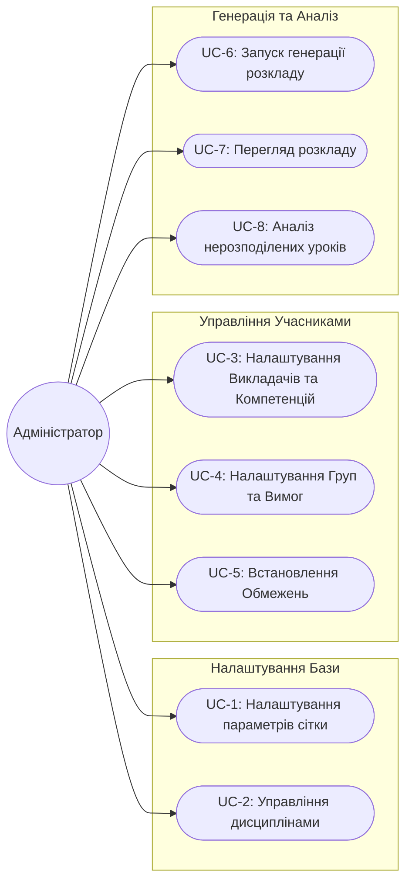
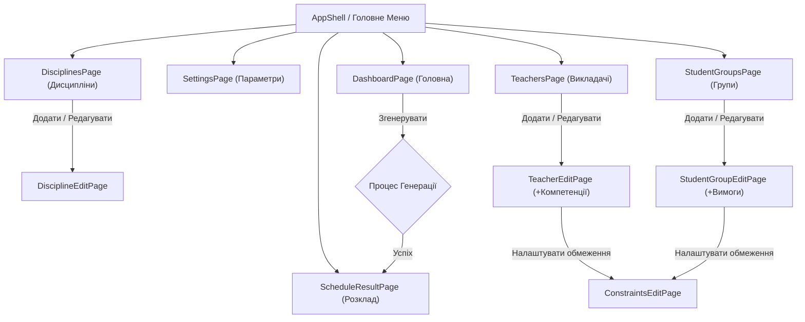
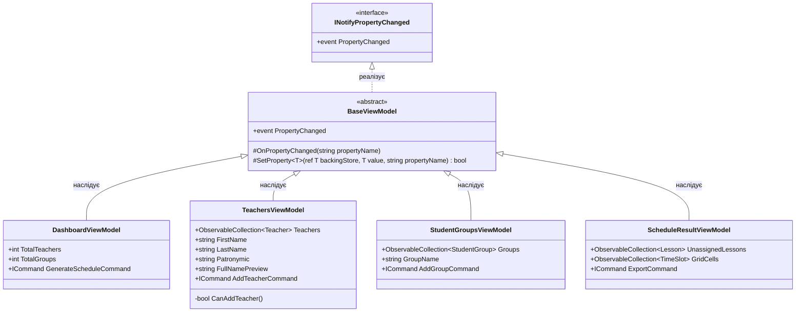

# Lab1MAUI: Генератор Розкладу

Цей проєкт є частиною лабораторної роботи з розробки мобільного застосунку на базі **.NET MAUI** з використанням архітектурного патерну **MVVM**. Основний функціонал застосунку — автоматична генерація навчального розкладу на основі заданих вхідних параметрів та обмежень.

## Особливості архітектури шару Model

Шар Model відповідає виключно за бізнес-логіку предметної області.

- **Предметна область (Навчальний план)**: Введено поняття дисциплін (`Discipline`) та типів занять (`LessonType`: Лекція, Практика, Лабораторна). Групи мають вимоги щодо кількості годин (`GroupRequirement`), а викладачі — свої компетенції (`TeacherCompetence`) та цільове навантаження.
- **Генерація замість видалення**: Уроки не передаються ззовні як готовий список. Замість цього метод `Schedule.InitializeData()` на основі вимог груп та компетенцій викладачів автоматично генерує (`спавнить`) об'єкти `Lesson`. Жодне обмеження не додає і не видаляє уроки — вони лише змінюють властивості (наприклад, призначають викладача чи змінюють час).
- **Композиція замість наслідування**: Викладачі та Групи володіють компонентом `TimeGrid`, який інкапсулює управління часовими комірками.
- **Гнучка система правил**: Усі вимоги щодо розкладу реалізовані через інтерфейс `IConstraint`.

---

## UML Діаграма (Шар Model)

Нижче наведена діаграма класів алгоритмічного ядра з урахуванням дисциплін та навчальних вимог:

## Сценарії використання (Use Cases)

Застосунок орієнтований на Адміністратора розкладу, який налаштовує вхідні дані та генерує розклад.

## Архітектура Інтерфейсу (UI Flow)

Для мобільного/десктопного застосунку на базі **.NET MAUI** ми використовуємо паттерн `AppShell` з бічним меню (Flyout) або вкладками (TabBar) для швидкого доступу до основних розділів, та стекову навігацію (Push/Pop) для сторінок редагування.

### Короткий опис сторінок
1. **DashboardPage**: Керуючий центр. Показує статистику (кількість груп, викладачів) і має головну кнопку "Згенерувати розклад".
2. **SettingsPage**: Форма для введення `Days` та `CellsPerDay`.
3. **DisciplinesPage / EditPage**: CRUD для предметів.
4. **TeachersPage / EditPage**: Список викладачів. На сторінці редагування можна додавати `TeacherCompetence` та переходити до списку персональних обмежень (`ConstraintsEditPage`).
5. **StudentGroupsPage / EditPage**: Список груп. На сторінці редагування можна додавати `GroupRequirement` (Скільки годин якого предмету треба) та переходити до їхніх обмежень.
6. **ScheduleResultPage**: Сторінка з `Picker` (вибір викладача або групи). Нижче відображається двовимірна сітка (CollectionView або Grid), де видно розклад обраного учасника. Також тут виводиться список нерозподілених уроків.

## Архітектура ViewModels (MVVM)

Тут наведено структуру класів ViewModel, яка відповідає всім вимогам лабораторної роботи (використання `INotifyPropertyChanged`, `ObservableCollection`, `ICommand` та `Data Binding`).

