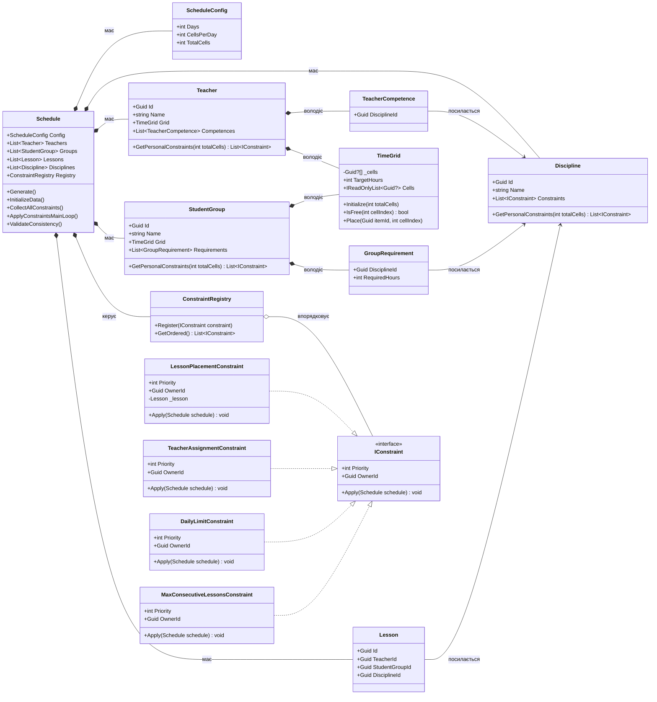
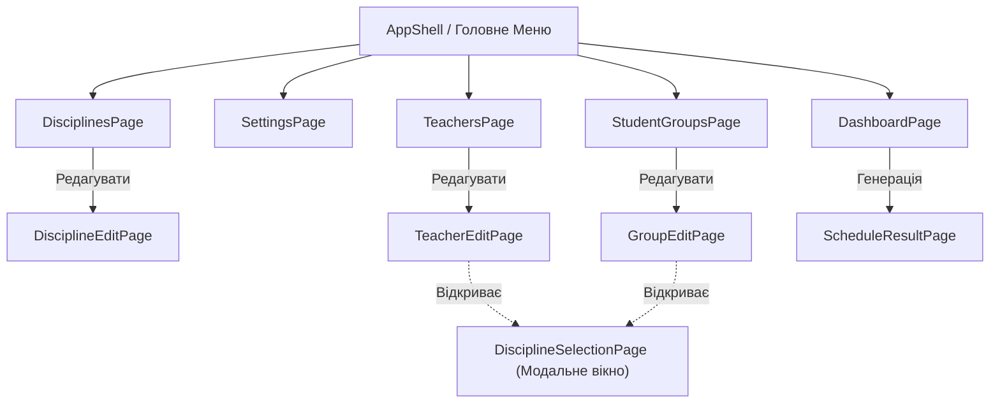
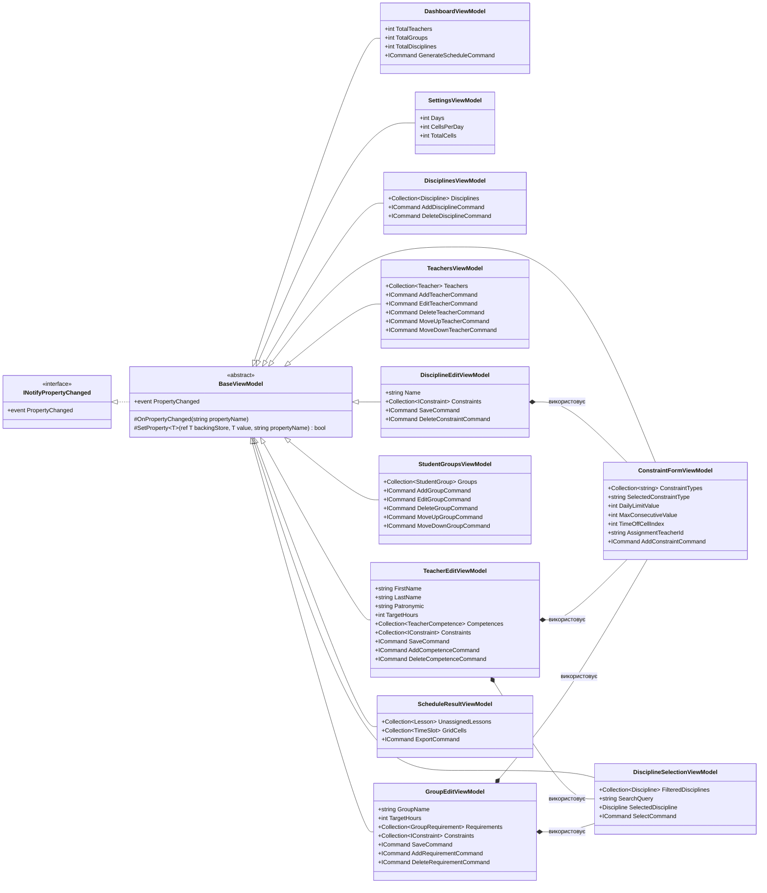

# Lab1MAUI: Генератор Розкладу

Цей проєкт є частиною лабораторної роботи з розробки мобільного застосунку на базі **.NET MAUI** з використанням архітектурного патерну **MVVM**. Основний функціонал застосунку — автоматична генерація навчального розкладу на основі заданих вхідних параметрів та обмежень.

## Особливості архітектури шару Model

Шар Model відповідає виключно за бізнес-логіку предметної області.

- **Предметна область (Навчальний план)**: Введено поняття дисциплін (`Discipline`). Тип заняття (Лекція, Практика, Лабораторна) більше не є окремим полем (`LessonType` видалено). Замість цього створюються окремі дисципліни з відповідною приставкою (наприклад, "Математика [Лк]", "Математика [Пр]"). Групи мають вимоги щодо кількості годин на дисципліну (`GroupRequirement`), а викладачі — свої компетенції (`TeacherCompetence`). Дисципліни, як і викладачі та групи, можуть мати власні обмеження (`Constraints`), які враховуються розкладом.
- **Генерація замість видалення**: Уроки не передаються ззовні як готовий список. Замість цього метод `Schedule.InitializeData()` на основі вимог груп та компетенцій викладачів автоматично генерує (`спавнить`) об'єкти `Lesson`. Жодне обмеження не додає і не видаляє уроки — вони лише змінюють властивості (наприклад, призначають викладача чи змінюють час).
- **Композиція замість наслідування**: Викладачі та Групи володіють компонентом `TimeGrid`, який інкапсулює управління часовими комірками.
- **Гнучка система правил**: Усі вимоги щодо розкладу реалізовані через інтерфейс `IConstraint`. При виборі дисципліни користувач не вписує її ID вручну — використовується випадаючий список з пошуком, реалізований через окрему ViewModel.

---

## UML Діаграма (Шар Model)

Нижче наведена діаграма класів алгоритмічного ядра з урахуванням дисциплін та навчальних вимог:

## Сценарії використання (Use Cases)

Застосунок орієнтований на Адміністратора розкладу, який налаштовує вхідні дані та генерує розклад.

## Архітектура Інтерфейсу (UI Flow)

Для мобільного/десктопного застосунку на базі **.NET MAUI** ми використовуємо паттерн `AppShell` з бічним меню (Flyout) або вкладками (TabBar) для швидкого доступу до основних розділів, та стекову навігацію (Push/Pop) для сторінок редагування.

### Деталі взаємодії (UI Flow)
1. **Головне меню (Flyout/Tabs)**: Швидка навігація між списками сутностей та налаштуваннями.
2. **DisciplineEditPage**: Дозволяє задати назву дисципліни (включаючи приставки `[Лк/Пр/Лб]`) та налаштувати специфічні для неї обмеження (через міні-меню на цій же сторінці).
3. **TeacherEditPage / GroupEditPage**: 
   - Налаштовує параметри викладача/групи.
   - Для прив'язки компетенцій чи вимог користувач не вводить ID вручну. Замість цього відкривається **DisciplineSelectionPage**.
   - **DisciplineSelectionPage**: Окреме модальне вікно або випадаючий компонент із рядком пошуку. Користувач вводить назву, бачить відфільтрований список і клікає на потрібну дисципліну, після чого вона автоматично прив'язується.
   - Має міні-меню (ConstraintForm) для додавання обмежень (з ручним сортуванням за пріоритетом).

## Архітектура ViewModels (MVVM)

Тут наведено структуру класів ViewModel, яка відповідає всім вимогам лабораторної роботи (використання `INotifyPropertyChanged`, `ObservableCollection`, `ICommand` та `Data Binding`).

