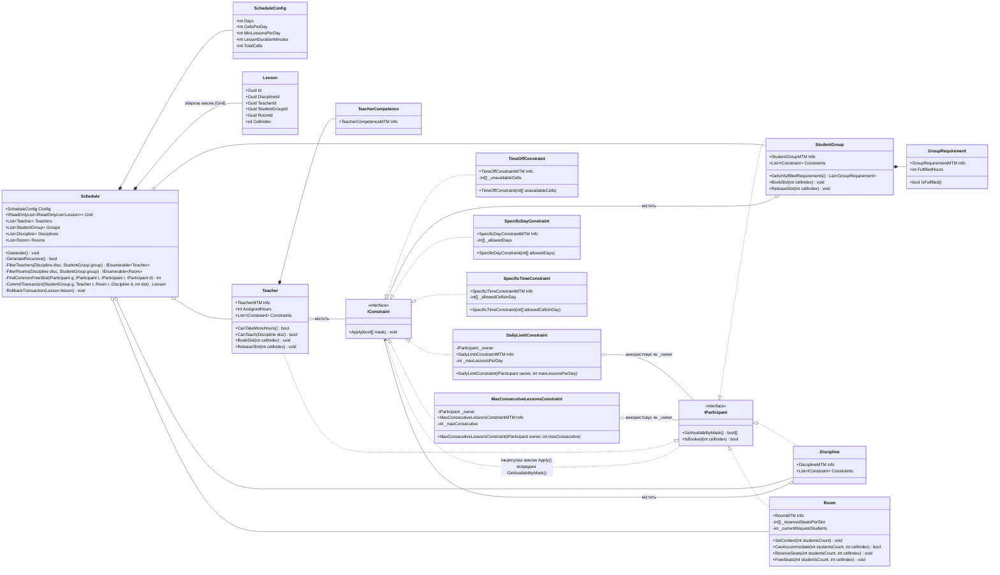
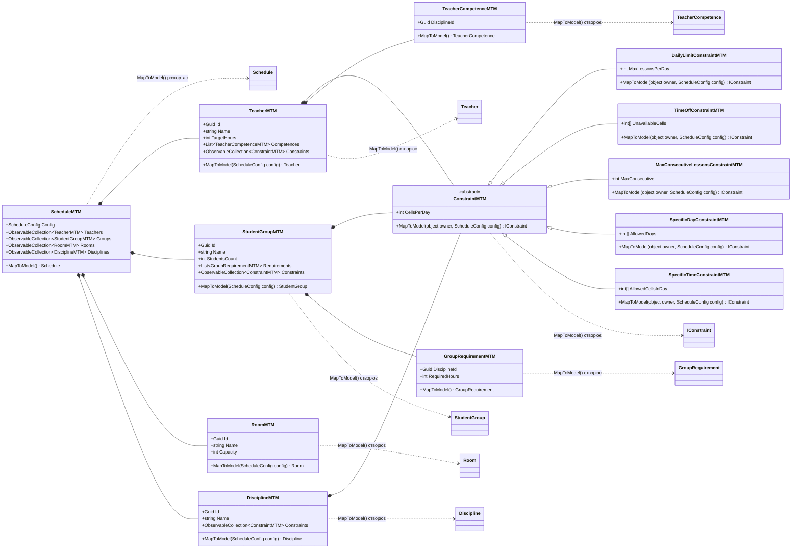
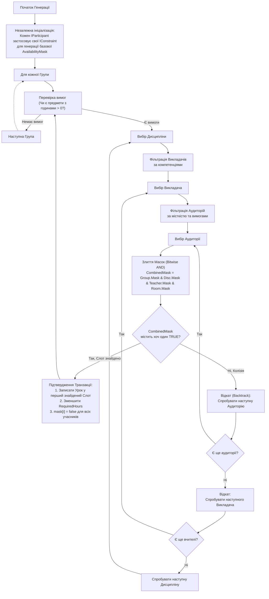
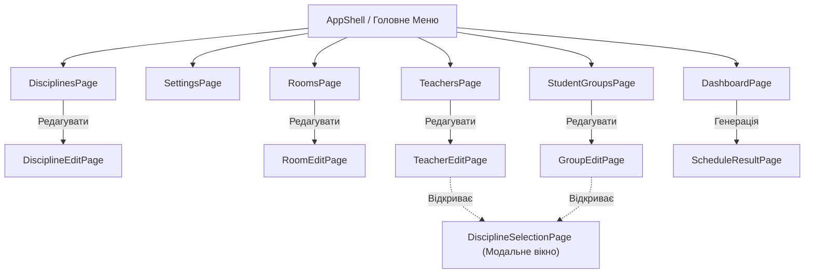
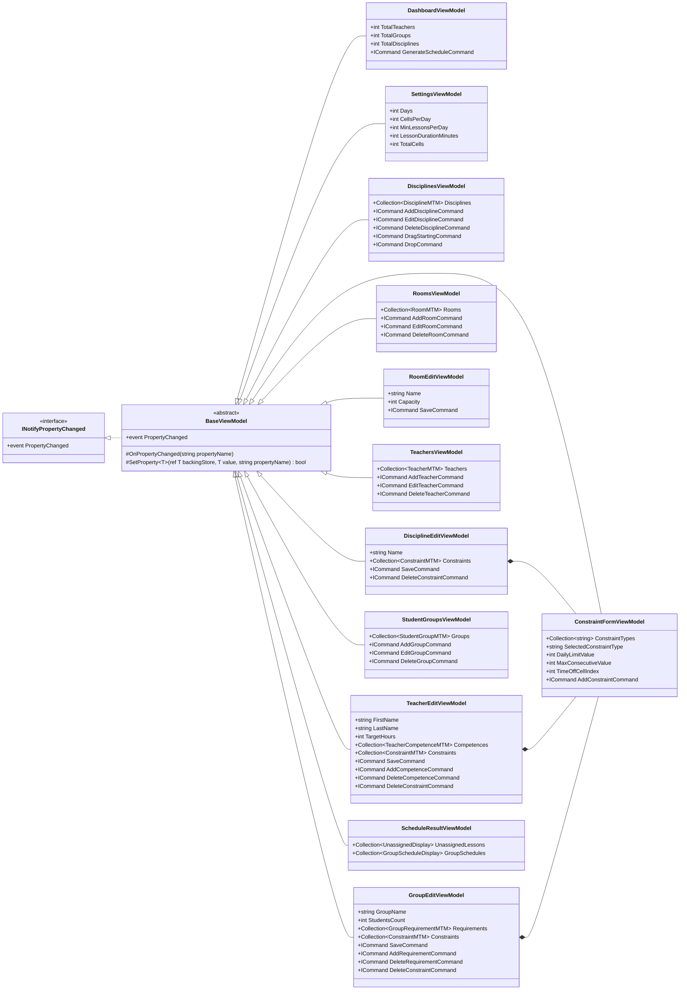

# Lab1MAUI: Генератор Розкладу

Цей проєкт є частиною лабораторної роботи з розробки мобільного застосунку на базі **.NET MAUI** з використанням архітектурного патерну **MVVM**. Основний функціонал застосунку — автоматична генерація навчального розкладу на основі заданих вхідних параметрів та обмежень.

## Особливості архітектури шару Model (Транзакційна Модель)

Шар Model відповідає виключно за бізнес-логіку предметної області. Оновлена архітектура орієнтована на **транзакційність** та **маніпуляцію булевими масками** для швидкого і надійного пошуку вільних слотів (комірок).

### Ключові принципи:
1. **Єдиний інтерфейс учасника (`IParticipant`)**: Всі сутності (Група, Викладач, Дисципліна, Аудиторія) реалізують цей інтерфейс. Вони мають спільну булеву маску вільного часу (`AvailabilityMask`), де `true` — слот вільний, `false` — слот заблокований або зайнятий.
2. **Єдина централізована Сітка Часу (`TimeGrid`) у `Schedule`**: Сітка часу більше не розпорошена всередині кожного викладача чи групи. Тепер саме `Schedule` володіє `Grid`, що містить розміщені уроки (`Lesson`), тоді як учасники оперують лише легкими булевими масками доступності.
3. **Незалежна Попередня Фільтрація (Pre-calculation)**: Застосування обмежень відбувається *незалежно перед генерацією розкладу*. Кожне обмеження має доступ тільки до інформації свого власника і модифікує виключно його персональну маску.
4. **Транзакційність через Злиття (Bitwise AND)**: Під час відбору до уроку ми робимо побітове `AND` масок учасників (`Group.Mask & Discipline.Mask & Teacher.Mask & Room.Mask`), щоб дізнатися, чи є вільний перетин. Якщо є хоча б одне `true`, ми "коммітимо" транзакцію: створюємо урок, записуємо його у `Schedule.Grid` і позначаємо цей слот як `false` в масках учасників. Якщо `true` немає — виконується відкат (Backtrack).

## UML Діаграма (Шар Model)

### UML Діаграма (Ієрархія MTM / DTO)

### Алгоритм Генерації (Backtracking)

## Сценарії використання (Use Cases)

Застосунок орієнтований на Адміністратора розкладу, який налаштовує вхідні дані та генерує розклад.

## Архітектура Інтерфейсу (UI Flow)

Для мобільного/десктопного застосунку на базі **.NET MAUI** ми використовуємо паттерн `AppShell` з бічним меню (Flyout) або вкладками (TabBar) для швидкого доступу до основних розділів, та стекову навігацію (Push/Pop) для сторінок редагування.

### Деталі взаємодії (UI Flow)
1. **Головне меню (Flyout/Tabs)**: Швидка навігація між списками сутностей та налаштуваннями.
2. **DisciplineEditPage**: Дозволяє задати назву дисципліни та налаштувати специфічні для неї обмеження.
3. **RoomEditPage**: Дозволяє задати назву (номер) аудиторії та її місткість (`Capacity`).
4. **TeacherEditPage / GroupEditPage**: 
   - Налаштовує параметри викладача/групи.
   - Для прив'язки компетенцій чи вимог користувач відкриває **DisciplineSelectionPage**.
   - **DisciplineSelectionPage**: Окреме модальне вікно або випадаючий компонент із рядком пошуку.
   - Має міні-меню (ConstraintForm) для додавання обмежень (з ручним сортуванням за пріоритетом).

## Архітектура ViewModels (MVVM)

У цій версії архітектури **ViewModels працюють виключно з MTM (MapToModel)**, діючи як "губка", що накопичує налаштування користувача. 
Класи доменної моделі (`Teacher`, `Schedule` тощо) не існують у пам'яті постійно. Вони конструюються динамічно з цих MTM **лише в момент натискання кнопки Генерації**, отримуючи актуальні розміри сітки, після чого відпрацьовують алгоритм і знищуються.

