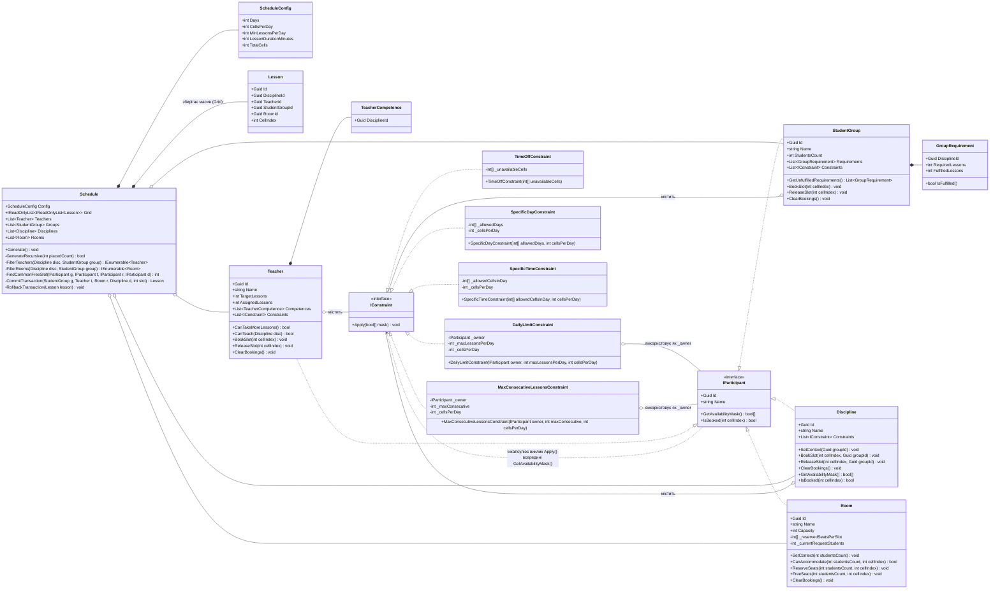
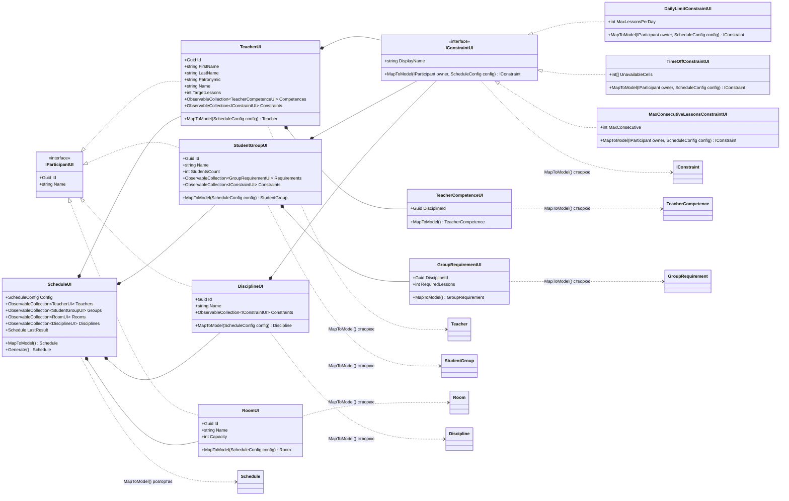
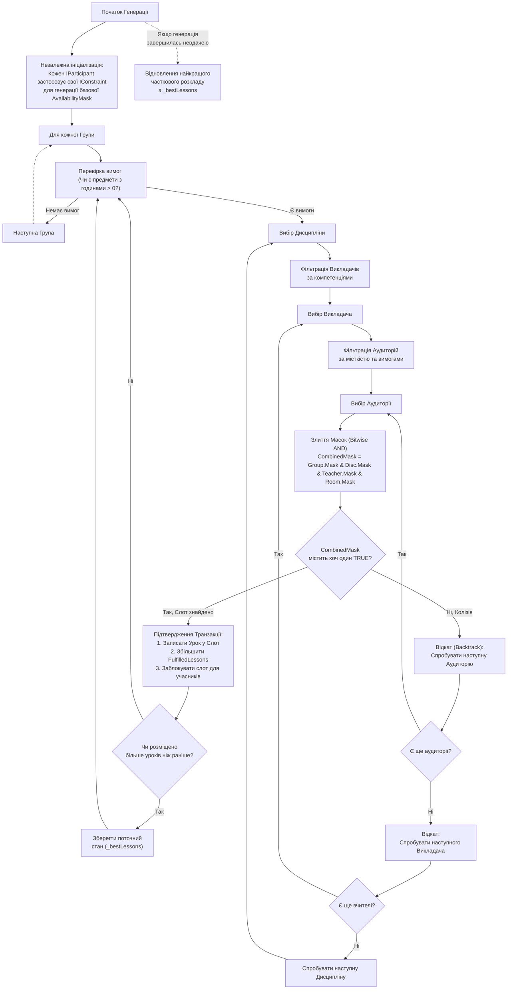
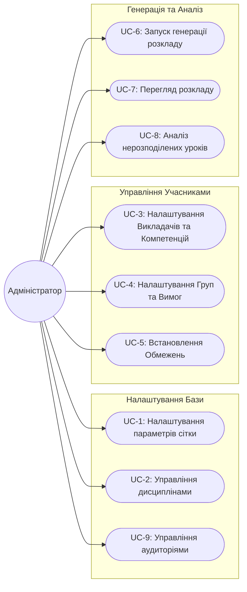
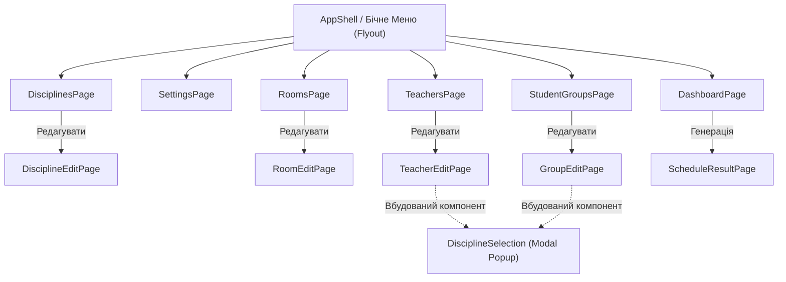
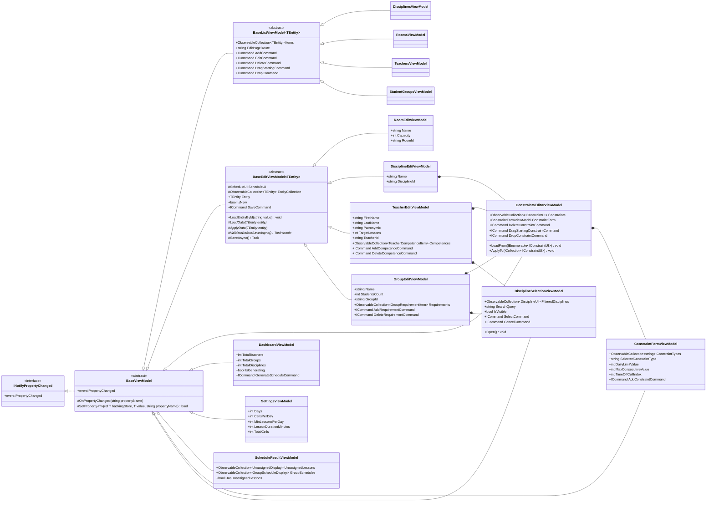

# Lab1MAUI: Генератор Розкладу

Цей проєкт є частиною лабораторної роботи з розробки мобільного застосунку на базі **.NET MAUI** з використанням архітектурного патерну **MVVM**. Основний функціонал застосунку — автоматична генерація навчального розкладу на основі заданих вхідних параметрів та обмежень.

## Особливості архітектури шару Model (Транзакційна Модель)

Шар Model відповідає виключно за бізнес-логіку предметної області. Оновлена архітектура орієнтована на **транзакційність** та **маніпуляцію булевими масками** для швидкого і надійного пошуку вільних слотів (комірок).

### Ключові принципи:
1. **Єдиний інтерфейс учасника (`IParticipant`)**: Всі сутності (Група, Викладач, Дисципліна, Аудиторія) реалізують цей інтерфейс. Вони мають спільну булеву маску вільного часу (`AvailabilityMask`), де `true` — слот вільний, `false` — слот заблокований або зайнятий.
2. **Єдина централізована Сітка Часу (`TimeGrid`) у `Schedule`**: Сітка часу більше не розпорошена всередині кожного викладача чи групи. Тепер саме `Schedule` володіє `Grid`, що містить розміщені уроки (`Lesson`), тоді як учасники оперують лише легкими булевими масками доступності.
3. **Незалежна Попередня Фільтрація (Pre-calculation)**: Застосування обмежень відбувається *незалежно перед генерацією розкладу*. Кожне обмеження має доступ тільки до інформації свого власника і модифікує виключно його персональну маску.
4. **Транзакційність через Злиття (Bitwise AND)**: Під час відбору до уроку ми робимо побітове `AND` масок учасників (`Group.Mask & Discipline.Mask & Teacher.Mask & Room.Mask`), щоб дізнатися, чи є вільний перетин. Якщо є хоча б одне `true`, ми "коммітимо" транзакцію: створюємо урок, записуємо його у `Schedule.Grid` і позначаємо цей слот як `false` в масках учасників. Якщо `true` немає — виконується відкат (Backtrack).

## UML Діаграма (Шар Model)

### UML Діаграма (Ієрархія UI Models (Presentation Layer))

### Алгоритм Генерації (Backtracking)

### Часткова Генерація (Best Partial Schedule)
Замість того, щоб переривати роботу помилкою при неможливості виконати всі 100% обмежень, алгоритм використовує евристику збереження найкращого проміжного результату. 
Під час рекурсивного пошуку він відстежує максимальну кількість успішно розміщених уроків. Якщо ідеальний розклад не знайдено (наприклад, через конфлікт `Teacher Daily Limit` та `Group Specific Day`), алгоритм **відновлює найкращий збережений частковий стан** і відображає його користувачу в UI, де чітко вказує нерозподілені години.

## Сценарії використання (Use Cases)

Застосунок орієнтований на Адміністратора розкладу, який налаштовує вхідні дані та генерує розклад.

## Архітектура Інтерфейсу (UI Flow)

Для застосунку на базі **.NET MAUI** використовується патерн `AppShell` з бічним меню (Flyout) для швидкого доступу до основних розділів, та стекова навігація (Push/Pop через Shell Routes) для сторінок редагування.

### Деталі взаємодії (UI Flow)
1. **Головне меню (Flyout)**: Швидка навігація бічним меню між списками сутностей та налаштуваннями.
2. **DisciplineEditPage**: Дозволяє задати назву дисципліни та налаштувати обмеження (через вбудовану форму `ConstraintForm`).
3. **RoomEditPage**: Дозволяє задати назву (номер) аудиторії та її місткість (`Capacity`).
4. **TeacherEditPage / GroupEditPage**: 
   - Налаштовує параметри викладача/групи.
   - Для додавання компетенцій чи вимог містить вбудований компонент **DisciplineSelection** (`Frame`), який відкривається прямо на сторінці з рядком живого пошуку.
   - Містить форму **ConstraintForm** для додавання обмежень (з ручним упорядкуванням drag-and-drop).

## Архітектура ViewModels (MVVM)

У цій версії архітектури **ViewModels працюють виключно з UI моделями (Presentation Models)**, діючи як "губка", що накопичує налаштування користувача. 
Класи доменної моделі (`Teacher`, `Schedule` тощо) не існують у пам'яті постійно. Вони конструюються динамічно з цих UI моделей **лише в момент натискання кнопки Генерації**, отримуючи актуальні розміри сітки, після чого відпрацьовують алгоритм і знищуються.

### Уніфікація та усунення дублювання (Шаблони проектування)

Для усунення надлишкового бойлерплейту архітектуру ViewModels оптимізовано за допомогою узагальнених базових класів та компонентного підходу:

1. **Уніфікований шар спискових моделей (`BaseListViewModel<TEntity>`)**:
   - Реалізує шаблонний життєвий цикл CRUD для сутностей, що реалізують `IParticipantUI`:
     - Навігаційні команди створення (`AddCommand`) та редагування (`EditCommand`) з переходом через Shell (`GoToAsync`).
     - Команда видалення (`DeleteCommand`).
     - Повноцінна підтримка Drag-and-Drop із реордерингом елементів списку (`DragStartingCommand`, `DropCommand` та `Items.Move`).
   - Спискові моделі учасників (`TeachersViewModel`, `RoomsViewModel`, `DisciplinesViewModel`, `StudentGroupsViewModel`) винесені в окрему підпапку `ViewModels/Participants/` (простір імен `Lab1MAUI.ViewModels.Participants`) за аналогією до `Models/UI/Participants/`. Вони є лаконічними типізованими спадкоємцями `BaseListViewModel<TEntity>`, що конфігурують джерело даних і роут для DI та сторінок.

2. **Інкапсуляція управління обмеженнями (`ConstraintsEditorViewModel`)**:
   - Відокремлений компонент, який інкапсулює колекцію обмежень `Constraints`, форму вибору `ConstraintFormViewModel`, команди видалення та перетягування обмежень.
   - Забезпечує стандартизоване копіювання правил при завантаженні та збереженні через методи `LoadFrom(...)` та `ApplyTo(...)`.

3. **Уніфікований шар редагування (`BaseEditViewModel<TEntity>`)**:
   - `BaseEditViewModel<TEntity>`: автоматизує обробку Shell `[QueryProperty]` для завантаження за ID або створення нового екземпляра (`"new"`), керує станом `IsNew`, надає гачок асинхронної валідації `ValidateBeforeSaveAsync()`, синхронізацію в колекції `ScheduleUI` та зворотну навігацію `..`. 
   - Моделі редагування (`TeacherEditViewModel`, `GroupEditViewModel`, `DisciplineEditViewModel`, `RoomEditViewModel`) напряму наслідують `BaseEditViewModel<TEntity>`, утворюючи просту пласку ієрархію без проміжних класів, та використовують композицію з дочірніми компонентами `ConstraintsEditorViewModel` і `DisciplineSelectionViewModel`.
   - **Структура папок**: Усі класи редагування, базові моделі та форми винесені в окрему підпапку `ViewModels/Edit/` (простір імен `Lab1MAUI.ViewModels.Edit`), а відповідні XAML-сторінки редагування — у підпапку `Views/Edit/` (простір імен `Lab1MAUI.Views.Edit`). Спискові сторінки учасників згруповані у підпапку `Views/Participants/` (простір імен `Lab1MAUI.Views.Participants`) за аналогією до `ViewModels/Participants/` та `Models/UI/Participants/`, тоді як у коренях `ViewModels/` та `Views/` залишаються головні сторінкові компоненти.

4. **Чітке структурування учасників розкладу (`Participants`) у Domain та Presentation (UI) шарах**:
   - **`Models/Schedule/Participants/`**: підпапка містить виключно сутності, що реалізують доменний інтерфейс `IParticipant` (`Teacher`, `StudentGroup`, `Discipline`, `Room`, `IParticipant`). Допоміжні класи зв'язків та вимог (`GroupRequirement`, `TeacherCompetence`), які не наслідують `IParticipant`, винесені безпосередньо в корінь `Models/Schedule/`.
   - **`Models/UI/Participants/`**: дзеркальна структура в шарі представлення (UI). Містить інтерфейс `IParticipantUI` (що містить `Guid Id` та `string Name`) та всі сутності-учасники: `TeacherUI`, `StudentGroupUI`, `DisciplineUI`, `RoomUI`. Загальні або допоміжні класи (`GroupRequirementUI`, `TeacherCompetenceUI`, `ScheduleUI`) розташовані на рівні `Models/UI/`.

## Покриття Тестами (Testing Suite)

Проєкт містить 51 автоматизований xUnit тест, що гарантує надійність алгоритму та архітектури.

1. **Базові тести алгоритму (`FunctionalAlgorithmTests`, `ScheduleGenerationTests`, `ScheduleTests`)**: Перевіряють здатність алгоритму заповнювати сітку без конфліктів, розпізнавати нестачу аудиторій, перевіряти місткість та обробляти базові прив'язки й розмірності.
2. **Ізольовані обмеження (`IndividualConstraintTests`, `ConstraintTests`)**: Тестують поведінку `DailyLimit`, `MaxConsecutive`, `SpecificDay`, `SpecificTime` та `TimeOff` незалежно для кожного типу учасника.
3. **Комбінаторні тести та граничні випадки (`CombinatorialScheduleTests`, `ComplexScheduleTests`, `EdgeCaseTests`)**: Набір тестів для перевірки складних багатовимірних перетинів та екстремальних умов:
   - Конфлікти між обмеженнями Групи та Викладача (напр. *Teacher TimeOff vs Group Specific Day*).
   - Динаміка "пляшкових горлечок" (bottlenecks) через нестачу кімнат чи годин викладача.
   - Екстремальні значення та граничні випадки (напр. ліміт 0 уроків на день, заборона ставити підряд в умовах короткого дня, неможливі вимоги).
   - Масштабні стрес-тести (100+ уроків, 10 груп, 10 викладачів).
4. **Тести інфраструктури UI Models (`ViewModelIntegrationTests`, `MultipleRegenerationTests`)**: Перевіряють, що багаторазова регенерація розкладу через UI-прошарок не залишає "брудного стану" (сміттєві лічильники годин, хибні маски) між натисканнями кнопки.
